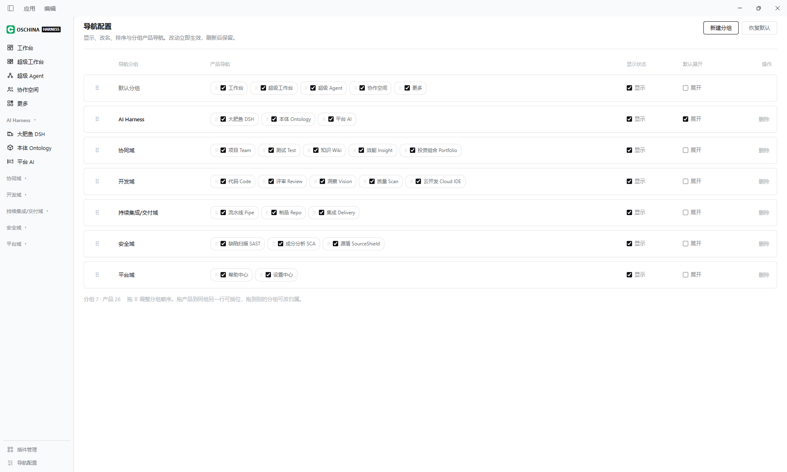

# dsh-osc-harness-sidebar

> Turn DeepSeek Harness into your own Agent Harness — the shell layer: a configurable product rail.

[English](README.en.md) | **[中文](README.md)**

[](https://www.npmjs.com/package/dsh-osc-harness-sidebar)
[](LICENSE)
[](package.json)
[](https://github.com/feralpixel2026/dsh-osc-harness-sidebar/actions/workflows/ci.yml)

`dsh-plugin` `dsh-bundle` `deepseek-harness` `cordis` `sidebar` `navigation` `ai-agent`

DSH designs `sidebar` as a seat, but draws only a session list in it by default. Plugins can attach to that region, but the result tends to become long and complicated. This plugin turns it into a rail that can hold any number of capabilities.

---

## Contents

- [Why this exists](#why-this-exists)
- [The interface](#the-interface)
- [In practice](#in-practice)
- [Quick start](#quick-start)
- [This plugin ships no capabilities](#this-plugin-ships-no-capabilities)
- [Built-in row: 大肥鱼 DSH](#built-in-row-大肥鱼-dsh)
- [Navigation settings](#navigation-settings)
- [Writing a plugin for this rail](#writing-a-plugin-for-this-rail)
- [How the install works](#how-the-install-works)
- [Caveats](#caveats)
- [Compatibility](#compatibility)
- [Package layout](#package-layout)
- [Documentation](#documentation)
- [Development](#development)
- [Security boundary](#security-boundary)
- [Related plugins](#related-plugins)
- [License](#license)

---

## Why this exists

DSH designs the left column as a **seat**: whoever takes it decides what the column looks like. The default `ui-sidebar` takes it and draws a session list — entirely the right shape for a single-conversation app.

But the region is open by design, and any plugin can take it over. The catch is not taking it over; the catch is that **the column tends to become long and complicated once you do** — capabilities pile into one flat list with no grouping, no hierarchy, and nothing the user can adjust.

This plugin turns that region into a **rail that can hold any number of capabilities**:

```
┌──────────────┬────────────────────────┐
│  Product     │  Sub-navigation of the  │   ← left column, split in two
│  rail        │  selected capability    │
│  (this       │  (provided by each      │
│   plugin)    │   capability plugin)    │
└──────────────┴────────────────────────┘
```

Groups, order and visibility are all configured visually. The native conversation and agent loop are not replaced — they become one row on the rail.

### How it is meant to be used: let DSH write the plugins

Together with DSH's built-in `cordis-plugin-development` capability, **you describe a plugin and DSH writes it** — turning the DSH client into a personal super workbench.

A page plugin only registers one rail row and one page. The prompt can be a single sentence:

> Build a simple page plugin and put it on the `sidebar.products` rail

The registration rules are in [Writing a plugin for this rail](#writing-a-plugin-for-this-rail).

---

## The interface

The left column becomes:

```
OSCHINA HARNESS              ← brand mark

Default group (untitled)
  Workbench / Super workbench / Collaboration

AI Harness
  大肥鱼 DSH                 ← built in: returns to the native DSH conversation
  Ontology                   ← needs dsh-product-ontology
  Platform AI                ← needs dsh-product-platform-ai

──── footer ────
  Plugin management
  Navigation settings        ← groups, order and visibility are configured here
```

- **Product rail**: group titles plus one row per registered capability, collapsible
- **Navigation settings**: add, remove, rename, drag-reorder groups; toggle visibility
- **大肥鱼 DSH**: the built-in exit — clicking it opens the right column and restores DSH's native navigation

**A fresh install shows only these two groups.** The remaining business-domain groups are hidden by default; turn them on in the settings page.

---

## In practice

Everything below comes from a real local install, after DSH produced plugins from the prompt above on the spot.

<!-- Screenshots: drop images into docs/screenshots/ and uncomment -->
<!--  -->
<!--  -->
<!--  -->
<!--  -->
<!--  -->
<!--  -->
<!--  -->
<!--  -->

---

## Quick start

### Requirements

- DSH 0.2.x
- Node.js >= 22

### DSH comes in two shapes, installed differently

| Shape | Install |
|---|---|
| Desktop (Electron) | Option A |
| Web (browser) | Option B |
| Inside a DSH session | Option C |

### Option A: desktop (recommended)

1. Open the DSH desktop app
2. Settings → Plugins → Install from npm
3. Enter `dsh-osc-harness-sidebar@latest`
4. Restart DSH

<!-- Screenshot: Settings → Plugins install screen -->
<!--  -->

### Option B: web

From the profile directory (for example `~/.dsh/profiles/desktop/`):

```sh
npm install dsh-osc-harness-sidebar@latest
```

Then edit `package.json` in the same directory and add the package to the `bundles` array:

```json
"bundles": [
  "...",
  "dsh-osc-harness-sidebar"
]
```

Restart the DSH web server.

### Option C: from inside a DSH session

Give this repository URL to the DSH agent and ask it to follow Option B.

### Verify the install

```sh
# the package is in place
ls ~/.dsh/profiles/desktop/node_modules/dsh-osc-harness-sidebar

# the bundle is declared
grep dsh-osc-harness-sidebar ~/.dsh/profiles/desktop/package.json
```

After reloading the browser, the left column should be the product rail.

> **Upgrading from an older version**: your existing group visibility settings are kept. To return to the new factory default (only the default group and AI Harness visible), press **Reset** once on the Navigation settings page.

---

## This plugin ships no capabilities

**This plugin is only the shell: grouping, ordering, visibility, and the settings page.**

Every capability on the rail is registered by **another plugin**:

| Installed | What you see |
|---|---|
| This plugin only | Group titles + **大肥鱼 DSH** + the settings page; groups other than `AI Harness` are empty |
| Plus capability plugin A | A's row appears on the rail; clicking it opens A's page |

**This is by design, not a gap**: capabilities install on demand, upgrade independently and uninstall independently. Installing none of them does not affect the shell.

---

## Built-in row: 大肥鱼 DSH

`大肥鱼 DSH` is the only built-in rail row, and it is not a separate plugin.

Clicking it is equivalent to **returning to the native DSH conversation** — the right column becomes the conversation area and DSH's own navigation returns. It is the way back from product mode to conversation mode, which is why the shell must own it: it calls `ctx.layout.selectPanel(null)`, a capability only the seat occupant has.

---

## Navigation settings

The footer's "Navigation settings" opens the settings page, where you can:

| Action | Behaviour |
|---|---|
| **New group** | The group appears on the rail immediately |
| **Rename** | Click the pencil next to the name, or double-click the name; Enter saves |
| **Reorder** | Drag by the handle at the start of the row, release to apply |
| **Show / hide** | A hidden group leaves the rail; its products fall back to the default group |
| **Expanded by default** | Whether the group is expanded when the page opens |
| **Delete group** | Products are not deleted; they move to the end of the default group |

### Behaviour of the default group

The first row is the **default group** (no title drawn). It receives every unassigned product, and its identity is entirely fixed:

- cannot be hidden
- cannot be collapsed
- cannot be deleted
- **cannot be renamed**

**When you hide or delete a group, its products are appended to the default group after the ones already there. They do not disappear.**

Changes apply immediately and survive a reload.

---

## Writing a plugin for this rail ⭐⭐⭐⭐⭐

This plugin hard-codes no product. Which rows appear on the rail is decided entirely by plugins registering into slots.

### Slot list

After taking the `sidebar` seat, this plugin declares the following child slots. Third-party plugins register against them by name.

| Slot | Kind | Purpose |
|---|---|---|
| `sidebar.products` | list | **Product rows.** One registration = one rail entry |
| `sidebar.content` | keyed | **Sub-navigation**, rendered in the right column when the product is selected. Optional |
| `sidebar.columns` | list | Declares "keep the right column while I am selected" |
| `sidebar.rail.account` | list | Footer extension point, directly below "Plugin management" |

Groups are not slots: **the shell derives a row's group from its id**, and the user can drag any row into any group on the settings page. A new plugin therefore needs to know nothing about group ids.

> The five `sidebar.products.g-*` legacy group slots remain declared only so older plugins do not fail. The shell does not render them; `sidebar.products` is the single collection slot.

### Describing it instead of writing it

No code needed — hand this sentence to DSH:

> Build a simple page plugin and put it on the `sidebar.products` rail

DSH reads the slot protocol in this repository, produces a complete plugin package modelled on the `dsh-product-*` family, and builds it. You only mount it into the profile.

<!-- Screenshots: describing the prompt, then DSH producing the plugin -->
<!--  -->
<!--  -->

### A minimal working example

A complete client plugin package that registers one rail row and one page:

```js
// lib/client.js — loaded by window.__ModuleLoader__
window.__ModuleLoader__.load({
  id: 'dsh-product-hello',
  factory: (require) => {
    const react = require('react')
    const h = react.createElement

    return {
      name: 'dsh-product-hello',
      apply(ctx) {
        const ID = 'product-hello'

        // 1. one row on the rail
        ctx.slots.inject('sidebar.products', () => ctx.slots.register({
          name: 'sidebar.products',
          id: ID,
          order: 100,
          label: 'Hello',
        }, function RailRow() {
          return h('span', null, 'Hello')
        }))

        // 2. the page shown in the main area once selected
        ctx.slots.inject('main', () => ctx.slots.register(
          { name: 'main', key: ID },
          function Page() {
            return h('div', { style: { padding: 24 } }, 'Hello, Harness')
          },
        ))
      },
    }
  },
})
```

The accompanying `package.json` and patch:

```json
{
  "name": "dsh-product-hello",
  "version": "1.0.0",
  "type": "module",
  "main": "lib/index.js",
  "dsh": {
    "client": { "entry": "lib/client.js" },
    "bundle": { "patch": "cordis.patch.yml" }
  }
}
```

```yaml
# cordis.patch.yml
- insert:
    - id: dsh-product-hello
      name: dsh-product-hello
```

`lib/index.js` is the host-side stub: `export function apply() {}` is enough.

### Only five registration fields survive

`slots.register` keeps only `key` / `id` / `order` / `label` / `priority`. **Custom fields on the registration object are discarded** — which is exactly why `sidebar.columns` exists: to keep the right column while a row is selected, register another row into `sidebar.columns`; you cannot hang that on the product row itself.

### The right column (sub-navigation)

When a product needs the right column, register into `sidebar.content` using the same id as the key:

```js
ctx.slots.inject('sidebar.content', () => ctx.slots.register({
  name: 'sidebar.content',
  key: ID,
}, function SubNav() {
  return h('nav', null, 'Sub-navigation')
}))
```

Also register a row into `sidebar.columns` to declare "keep the right column while I am selected":

```js
ctx.slots.inject('sidebar.columns', () => ctx.slots.register({
  name: 'sidebar.columns',
  id: ID,
}))
```

**A product that does not register `sidebar.columns` gets no right column**; the main area uses the full width. This is deliberate: most pages do not need one, and reserving the space unconditionally would waste a quarter of the screen.

### Registration timing

Every child-slot registration must happen after `ctx.slots.inject('sidebar', ...)`. Slots such as `sidebar.products` exist only once this plugin has taken the `sidebar` seat; registering at the top level of `apply` throws `slot is not declared` and aborts the whole `apply`, which shows up as a blank left column that only a restart fixes.

### Icons

A product row's icon is provided by the slot content of its `sidebar.products` registration. The shell renders it with `renderSlot(section.slot, { size: 18, active }, { only: entry.id })` — 18 px, with the colour following the selected state.

---

## How the install works

DSH's plugin system is Cordis. This plugin ships three files:

| File | Role |
|---|---|
| `index.js` | Host entry; `apply()` is empty — no host service is needed |
| `client.js` | The entire browser-side implementation, loaded by the DSH web shell via the `dsh.client` manifest |
| `cordis.patch.yml` | Disables `ui-sidebar` and takes the `sidebar` seat |

**Disabling `ui-sidebar` lives in the bundle patch, not in your profile patch** — so uninstalling this plugin restores the native sidebar automatically, with no half-removed state left behind.

---

## Caveats

### Mutually exclusive with other sidebar plugins

This plugin takes the `sidebar` seat. **Do not enable it alongside another plugin that takes the same seat**, or you will get an `already declared` error or garbled column widths.

### Dependencies

**Zero runtime dependencies.** It requires no other plugin or shared library and installs and uninstalls on its own.

---

## Compatibility

| Item | Value |
|---|---|
| DSH | 0.2.x |
| Node.js | >= 22 |
| Platform | Web (`dsh.client.platform` is `web`) |
| Injected client services | `@deepseek-ai/dsh-client-locale`, `@deepseek-ai/dsh-client-ui-slots` |

---

## Package layout

A single-file front-end package with **no build step**:

```
index.js             Host entry (no host service, empty apply)
client.js            Entire browser-side implementation (~100 KB, styles included)
cordis.patch.yml     Bundle patch: disables ui-sidebar, takes the sidebar seat
icon.svg             Icon
locale/zh.json       Chinese strings
locale/en.json       English strings
```

`client.js` is hand-written and verified, and passes through no bundler. Styles ship inline with the package and are attached to the product page container at runtime, scoped to that container so host styles are untouched.

---

## Documentation

| File | Contents |
|---|---|
| [CHANGELOG.md](CHANGELOG.md) | Version history |
| [CONTRIBUTING.md](CONTRIBUTING.md) | Contribution guide |
| [SECURITY.md](SECURITY.md) | Security policy and vulnerability reporting |
| [docs/screenshots/](docs/screenshots/) | README screenshots and naming convention |

---

## Development

This repository contains runtime files only; there is no build pipeline.

```sh
npm run check    # syntax check
npm test         # run tests
npm run verify   # check + test (runs automatically before publish)
```

After editing `client.js`, reload the DSH web interface.

---

## Security boundary

This plugin:

- **makes no network requests**
- **reads no user files** (other than the navigation configuration kept in `localStorage`)
- **requests no elevated permissions**
- persists nothing except the group configuration in browser `localStorage`

See [SECURITY.md](SECURITY.md) for how to report a vulnerability.

---

## Related plugins

This plugin is the shell and ships no capabilities. For companion capability plugins, see the `dsh-product-*` family — each is an independent plugin providing one rail row and one page.

---

## License

[Apache-2.0](LICENSE)
