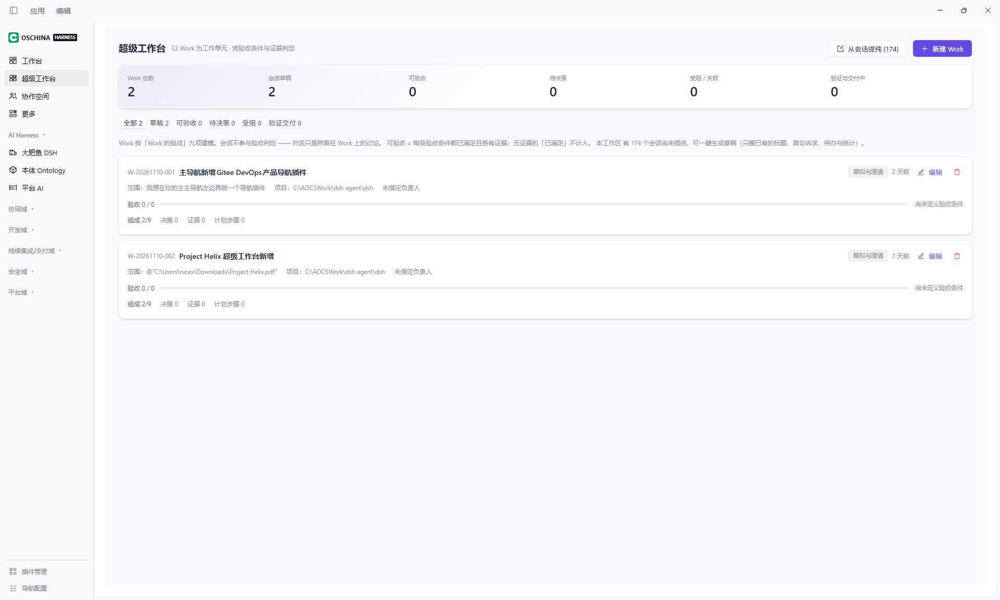
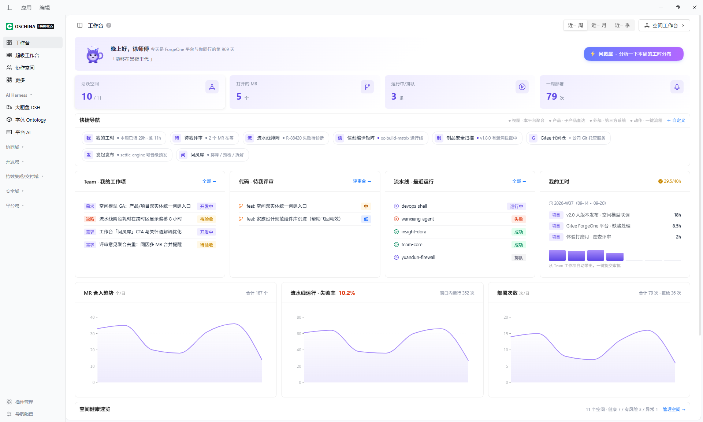
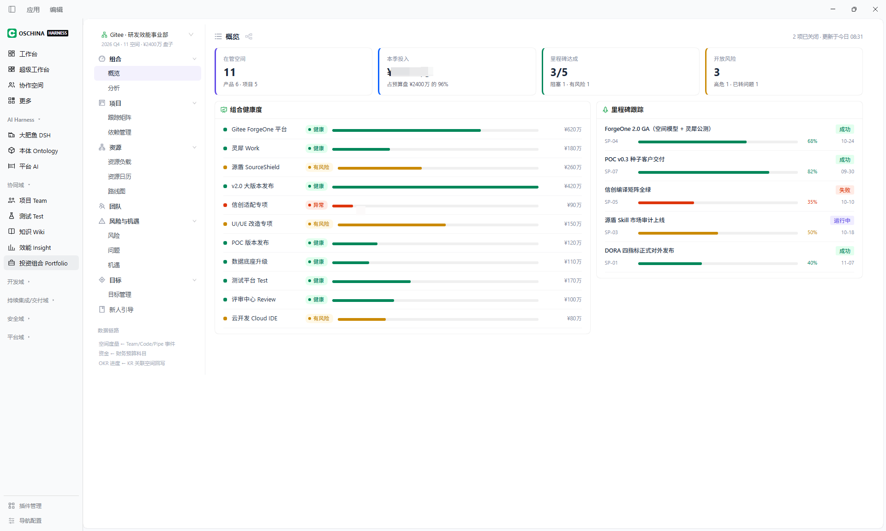
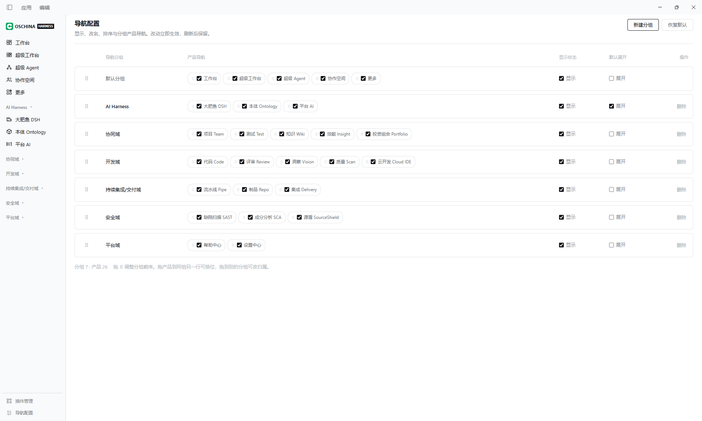

# dsh-osc-harness-sidebar

> Turn DeepSeek Harness into your own Agent Harness
> — from a single-mode agent app into an agent plus many products. A shell base for multi-product clients.

[English](README.en.md) | **[中文](README.md)**

[](https://www.npmjs.com/package/dsh-osc-harness-sidebar)
[](LICENSE)
[](package.json)
[](https://github.com/feralpixel2026/dsh-osc-harness-sidebar/actions/workflows/ci.yml)

`dsh-plugin` `dsh-bundle` `deepseek-harness` `cordis` `sidebar` `navigation` `ai-agent`

DSH designs `sidebar` as a seat, but draws only a session list in it by default. Plugins can attach to that region, but the result tends to become long and complicated. This plugin turns it into a rail that can hold any number of capabilities.

---

## Contents

- [What it solves](#what-it-solves)
- [This package is the shell only](#this-package-is-the-shell-only)
- [The interface](#the-interface)
- [In practice](#in-practice)
- [Quick start](#quick-start)
- [This plugin ships no capabilities](#this-plugin-ships-no-capabilities)
- [Built-in row: 大肥鱼 DSH](#built-in-row-大肥鱼-dsh)
- [Navigation settings](#navigation-settings)
- [Writing a plugin for this rail](#writing-a-plugin-for-this-rail)
- [How the install works](#how-the-install-works)
- [Caveats](#caveats)
- [Compatibility](#compatibility)
- [Package layout](#package-layout)
- [Documentation](#documentation)
- [Development](#development)
- [Security boundary](#security-boundary)
- [Related plugins](#related-plugins)
- [License](#license)

---

## What it solves

DSH designs the left column as a **seat**: whoever takes it decides what the column looks like. The default `ui-sidebar` takes it and draws a session list — the right shape for a single-conversation app.

The problem appears once that region is asked to carry more. It is open by design, and any plugin can take it over, but **taking it over is easy while making it legible is not**: capabilities go into the same list one at a time until the column is long and tangled, found by scrolling, with no grouping, no hierarchy, and nothing the user can adjust.

## What it does

It changes the sidebar from one list into a rail plus one level of sub-navigation:

```
┌──────────────┬────────────────────────┐
│  Product     │  Sub-navigation of the  │   ← left column, split in two
│  rail        │  selected product       │
│  (this       │  (provided by each      │
│   plugin)    │   product plugin)       │
└──────────────┴────────────────────────┘
```

- **Grouping, order and visibility** are configured visually, as local settings — no reinstall.
- **Nothing native is replaced.** The session list and the agent loop are still there; they become one row on the rail. This is not a different app, it is product capability layered beside the agent.
- **A product can carry its own sub-navigation.** Taking the `sidebar.columns` seat declares the right column; a product that does not declare it gets no right column. That is an explicit declaration, not a guess by the shell.

## Why this is possible

Because DSH is a full Cordis plugin architecture: seats are open, and a page-level product costs about a row plus a page.

Attaching a product needs no change to this plugin, no rebuild, and no release — two registrations and it appears.

## Letting DSH write the plugins

Together with DSH's built-in `cordis-plugin-development` capability, you can grow new capability by describing it. The prompt can be one line:

> make a simple page plugin and put it in the `sidebar.products` rail

Protocol details — two registrations, five surviving fields, the three declarations for a right column — are in [Writing a plugin for this rail](#writing-a-plugin-for-this-rail).

## This package is the shell only

**It ships no products.** After installing you get an empty rail and the native conversation. What it becomes depends on what you attach.

The screenshots in this README come from locally attached product plugins (a Gitee DevOps set). **Those products are not in this package** and are not on npm — they demonstrate what the shell can carry. If you want a ready-made product set, this package is not it.
---

## The interface

The left column becomes:

```
OSCHINA HARNESS              ← brand mark

Default group (untitled)
  Workbench / Super workbench / Collaboration

AI Harness
  大肥鱼 DSH                 ← built in: returns to the native DSH conversation
  Ontology                   ← needs dsh-product-ontology
  Platform AI                ← needs dsh-product-platform-ai

  More                       ← last row of the default group: create your plugin / browse plugins

──── footer ────
  Plugin management
  Navigation settings        ← groups, order and visibility are configured here
```

- **Product rail**: group titles plus one row per registered capability, collapsible
- **Navigation settings**: add, remove, rename, drag-reorder groups; toggle visibility
- **大肥鱼 DSH**: the built-in exit — clicking it opens the right column and restores DSH's native navigation
- **More**: the last row of the default group, described below

**A fresh install shows only these two groups.** The remaining business-domain groups are hidden by default; turn them on in the settings page.

### Two "More" entries

The default group and the panel list each end with a More entry. **They serve different purposes; they are not two copies of one menu.**

| Where | Menu | Purpose |
|---|---|---|
| **End of the default group (product rail)** | Create your plugin / Browse plugins | Add something **to this rail**. The first item opens a cordis session with a seeded prompt that asks the agent to locate this package and read the integration section of this README; it leaves product name, id, and page content blank. The second opens plugin management. It lives inside the default group, so folding that group hides it — it is one of that group's rows |
| **End of the panel list (right column)** | Rows registered into `sidebar.panellist.actions` (unpinned panels and two plugin actions, supplied by `ui-entry-customization`), plus a fallback list of unpinned panels | **Recover a panel you unpinned.** It sits where native `ui-sidebar` puts its own More — after the panel rows — because it is that entry's counterpart in this shell |

The rail entry is **specific to this shell**: native has no equivalent, and its prompt differs (native opens an empty editor). The panel-list entry **restores native behaviour**: `sidebar.panellist.actions` has always been declared and third parties have always registered into it; it simply had no outlet before.

---

## In practice

Everything below comes from a real local install, after DSH produced plugins from the prompt above on the spot.










---

## Quick start

### Requirements

- DSH 0.2.x
- Node.js >= 22

### DSH comes in two shapes, installed differently

| Shape | Install |
|---|---|
| Desktop (Electron) | Option A |
| Web (browser) | Option B |
| Inside a DSH session | Option C |

### Option A: desktop (recommended)

1. Open the DSH desktop app
2. Settings → Plugins → Install from npm
3. Enter `dsh-osc-harness-sidebar@latest`
4. Restart DSH


### Option B: web

From the profile directory (for example `~/.dsh/profiles/desktop/`):

```sh
npm install dsh-osc-harness-sidebar@latest
```

Then edit `package.json` in the same directory and add the package to the `bundles` array:

```json
"bundles": [
  "...",
  "dsh-osc-harness-sidebar"
]
```

Restart the DSH web server.

### Option C: from inside a DSH session

Give this repository URL to the DSH agent and ask it to follow Option B.

### Verify the install

```sh
# the package is in place
ls ~/.dsh/profiles/desktop/node_modules/dsh-osc-harness-sidebar

# the bundle is declared
grep dsh-osc-harness-sidebar ~/.dsh/profiles/desktop/package.json
```

After reloading the browser, the left column should be the product rail.

> **Upgrading from an older version**: your existing group visibility settings are kept. To return to the new factory default (only the default group and AI Harness visible), press **Reset** once on the Navigation settings page.

---

## This plugin ships no capabilities

**This plugin is only the shell: grouping, ordering, visibility, and the settings page.**

Every capability on the rail is registered by **another plugin**:

| Installed | What you see |
|---|---|
| This plugin only | Group titles + **大肥鱼 DSH** + the settings page; groups other than `AI Harness` are empty |
| Plus capability plugin A | A's row appears on the rail; clicking it opens A's page |

**This is by design, not a gap**: capabilities install on demand, upgrade independently and uninstall independently. Installing none of them does not affect the shell.

---

## Built-in row: 大肥鱼 DSH

`大肥鱼 DSH` is the only built-in rail row, and it is not a separate plugin.

Clicking it is equivalent to **returning to the native DSH conversation** — the right column becomes the conversation area and DSH's own navigation returns. It is the way back from product mode to conversation mode, which is why the shell must own it: it calls `ctx.layout.selectPanel(null)`, a capability only the seat occupant has.

---

## Navigation settings

The footer's "Navigation settings" opens the settings page, where you can:

| Action | Behaviour |
|---|---|
| **New group** | The group appears on the rail immediately |
| **Rename** | Click the pencil next to the name, or double-click the name; Enter saves |
| **Reorder** | Drag by the handle at the start of the row, release to apply |
| **Show / hide** | A hidden group leaves the rail; its products fall back to the default group |
| **Expanded by default** | Whether the group is expanded when the page opens |
| **Delete group** | Products are not deleted; they move to the end of the default group |

### Behaviour of the default group

The first row is the **default group** (no title drawn). It receives every unassigned product, and its identity is entirely fixed:

- cannot be hidden
- cannot be collapsed
- cannot be deleted
- **cannot be renamed**

**When you hide or delete a group, its products are appended to the default group after the ones already there. They do not disappear.**

Changes apply immediately and survive a reload.

---

## Writing a plugin for this rail

This plugin hard-codes no product. Which rows appear on the rail is decided entirely by plugins registering into slots.

### Slot list

After taking the `sidebar` seat, this plugin declares the following child slots. Third-party plugins register against them by name.

| Slot | Kind | Purpose |
|---|---|---|
| `sidebar.products` | list | **Product rows.** One registration = one rail entry |
| `sidebar.content` | keyed | **Sub-navigation**, rendered in the right column when the product is selected. Optional |
| `sidebar.columns` | list | Declares "I have a column prepared" |
| `sidebar.columns.visible` | list | Declares "that column takes up space right now" |
| `sidebar.columns.collapsed` | list | Declares "force that column collapsed"; highest priority |
| `sidebar.rail.account` | list | Footer extension point, directly below "Plugin management" |
| `sidebar.panellist.actions` | list | Rows in the panel list's More menu. Register here and the row appears there |

Groups are not slots: **the shell derives a row's group from its id**, and the user can drag any row into any group on the settings page. A new plugin therefore needs to know nothing about group ids.

> The five `sidebar.products.g-*` legacy group slots remain declared only so older plugins do not fail. The shell does not render them; `sidebar.products` is the single collection slot.

> `sidebar.panellist.actions` receives `{ entries, onOpen, onPinnedChange, onDismiss }`: `entries` is the projection of unpinned panels, `onOpen(id)` switches panel, `onPinnedChange(id, pinned)` changes pin state, and `onDismiss()` closes the menu. When nothing is registered the shell lists `entries` itself, so the menu is never empty even without `ui-entry-customization`.

### Describing it instead of writing it

No code needed — hand this sentence to DSH:

> Build a simple page plugin and put it on the `sidebar.products` rail

DSH reads the slot protocol in this repository, produces a complete plugin package modelled on the `dsh-product-*` family, and builds it. You only mount it into the profile.


### A minimal working example

A complete client plugin package that registers one rail row and one page:

```js
// lib/client.js — loaded by window.__ModuleLoader__
window.__ModuleLoader__.load({
  id: 'dsh-product-hello',
  factory: (require) => {
    const react = require('react')
    const h = react.createElement

    return {
      name: 'dsh-product-hello',
      apply(ctx) {
        const ID = 'product-hello'

        // 1. one row on the rail
        ctx.slots.inject('sidebar.products', () => ctx.slots.register({
          name: 'sidebar.products',
          id: ID,
          order: 100,
          label: 'Hello',
        }, function RailRow() {
          return h('span', null, 'Hello')
        }))

        // 2. the page shown in the main area once selected
        ctx.slots.inject('main', () => ctx.slots.register(
          { name: 'main', key: ID },
          function Page() {
            return h('div', { style: { padding: 24 } }, 'Hello, Harness')
          },
        ))
      },
    }
  },
})
```

The accompanying `package.json` and patch:

```json
{
  "name": "dsh-product-hello",
  "version": "1.0.0",
  "type": "module",
  "main": "lib/index.js",
  "dsh": {
    "client": { "entry": "lib/client.js" },
    "bundle": { "patch": "cordis.patch.yml" }
  }
}
```

```yaml
# cordis.patch.yml
- insert:
    - id: dsh-product-hello
      name: dsh-product-hello
```

`lib/index.js` is the host-side stub: `export function apply() {}` is enough.

### Only three registration fields are read

This plugin reads three fields off a registration: `id`, `label` and `order`. **Any other custom field is discarded** — which is exactly why `sidebar.columns` exists: to keep the right column while a row is selected, register another row into `sidebar.columns`; you cannot hang that on the product row itself.

(`key` and `priority` are consumed by the slot runtime: the first indexes a `keyed` seat, the second decides contention for a `single` seat. Neither is data this shell reads when rendering.)

### The right column (sub-navigation)

When a product needs the right column, register into `sidebar.content` using the same id as the key:

```js
ctx.slots.inject('sidebar.content', () => ctx.slots.register({
  name: 'sidebar.content',
  key: ID,
}, function SubNav() {
  return h('nav', null, 'Sub-navigation')
}))
```

**Two further declarations are required; neither works alone.** Registering only `sidebar.columns`
reserves nothing -- this is the easiest mistake to make.

```js
// 1. "I have a column prepared"
ctx.slots.inject('sidebar.columns', () => ctx.slots.register({
  name: 'sidebar.columns',
  id: ID,
}))

// 2. "that column takes up space right now" -- omit this and no column appears
ctx.slots.inject('sidebar.columns.visible', () => ctx.slots.register({
  name: 'sidebar.columns.visible',
  id: ID,
}))
```

**Why two declarations**: `slots.register` keeps only `key` / `id` / `order` / `label` /
`priority`, so a plugin cannot attach "does this column have content right now" to the product row.
With dynamic content the shell still sees "declared" and leaves an empty column behind. Splitting it
lets the plugin withdraw `visible` when the content is empty, and the shell never has to guess.

**A product that registers neither gets no right column**; the main area uses the full width. Most
pages do not need one, and reserving the space unconditionally would waste a quarter of the screen.

Register `sidebar.columns.collapsed` (same id) to force it collapsed. It outranks the other two, so
they need not be withdrawn.

### Registration timing

Every child-slot registration must happen after `ctx.slots.inject('sidebar', ...)`. Slots such as `sidebar.products` exist only once this plugin has taken the `sidebar` seat; registering at the top level of `apply` throws `slot is not declared` and aborts the whole `apply`, which shows up as a blank left column that only a restart fixes.

### Icons

A product row's icon is provided by the slot content of its `sidebar.products` registration. The shell renders it with `renderSlot(section.slot, { size: 18, active }, { only: entry.id })` — 18 px, with the colour following the selected state.

### Full guide

The above is a quick tour. [docs/writing-a-plugin.md](docs/writing-a-plugin.md) has the step-by-step
walkthrough, a copyable package layout, style isolation and a pre-flight checklist.
[docs/integration.md](docs/integration.md) lists the four hard requirements.

---

## How the install works

DSH's plugin system is Cordis. This plugin ships three files:

| File | Role |
|---|---|
| `index.js` | Host entry; `apply()` is empty — no host service is needed |
| `client.js` | The entire browser-side implementation, loaded by the DSH web shell via the `dsh.client` manifest |
| `cordis.patch.yml` | Disables `ui-sidebar` and takes the `sidebar` seat |

**Disabling `ui-sidebar` lives in the bundle patch, not in your profile patch** — so uninstalling this plugin restores the native sidebar automatically, with no half-removed state left behind.

---

## Caveats

### Mutually exclusive with other sidebar plugins

This plugin takes the `sidebar` seat. **Do not enable it alongside another plugin that takes the same seat**, or you will get an `already declared` error or garbled column widths.

### Dependencies

**Zero runtime dependencies.** It requires no other plugin or shared library and installs and uninstalls on its own.

---

## Compatibility

| Item | Value |
|---|---|
| DSH | 0.2.x |
| Node.js | >= 22 |
| Platform | Web (`dsh.client.platform` is `web`) and the Electron desktop app |
| Minimum viewport | 390px (the `dsh-responsive-ui` acceptance floor) |
| Browsers | Safari 16.4+, Chrome 111+, Edge 111+ (uses `color-mix()` and `:has()`) |
| Injected client services | `@deepseek-ai/dsh-client-locale`, `@deepseek-ai/dsh-client-ui-slots` |

---

## Column geometry

The width this plugin occupies is a **design constant**, not something read back from the host:

| State | Product rail | Navigation column | Whole column |
|---|---|---|---|
| Expanded | 180 | 240 | **420** |
| Rail collapsed | 56 | 240 | 296 |
| Column collapsed | 56 | — | 56 |

`SIDEBAR_MAX_WIDTH = 420` matches the ui-layout ceiling, and the column is widened to it at start-up through a
capability probe.

**Do not couple those numbers to `props.width`.** It is ui-layout reporting the track this plugin pinned, so
deriving the rail width from it is circular: collapsing pins 296, the host reports 296, and on expand the stale
296 leaves the rail short of 180 and the navigation column at 100. For the same reason `useSoloTrack`'s
`widthFor` must not clamp to `hostWidth`.

Narrow viewports need no fallback here: ui-layout reports `collapsed` below 1024px and turns the column into a
drawer over the content below 768px. At 390px this plugin renders a 56px icon rail with no horizontal scroll.

## Touch and accessibility

| Convention | Implementation | Reason |
|---|---|---|
| Hover only on pointer devices | All 21 `:hover` rules sit inside `@media (hover: hover)` | A touchscreen has no pointer to leave, so a bare `:hover` latches: the row you tapped stays highlighted until you tap elsewhere, contradicting the real selection |
| Reduced motion respected | `@media (prefers-reduced-motion: reduce)` cuts transition and animation durations to 0.01ms | Durations are cleared, not properties, so layout and colour still apply immediately |
| 16px field floor on touch | `@media (pointer: coarse) { .pn-name-input { font-size: 16px } }` | iOS Safari zooms the page when a focused field is under 16px and does not zoom back on blur, distorting the fixed column geometry while it lasts |
| Selection changes background and ink only | `.pn-item[data-active]` sets no `font-weight` or `font-size` | A weight change alters glyph width, so the selected row turns bolder than its neighbours and shifts sideways |

`(pointer: coarse)` queries the primary pointer rather than the current event, so a hybrid device with a
trackpad keeps the compact sizes.

---

## Package layout

A single-file front-end package with **no build step**:

```
index.js             Host entry (no host service, empty apply)
client.js            Entire browser-side implementation (styles included)
cordis.patch.yml     Bundle patch: disables ui-sidebar, takes the sidebar seat
icon.svg             Icon
locale/zh.json       Package metadata (UI copy is inline in client.js)
locale/en.json       Package metadata
docs/                Integration documentation (shipped with the package)
test/                node --test unit tests (not shipped)
```

`client.js` is hand-written and verified, and passes through no bundler. Styles ship inline with the package and are attached to the product page container at runtime, scoped to that container so host styles are untouched.

---

## Documentation

| File | Contents |
|---|---|
| [CHANGELOG.md](CHANGELOG.md) | Version history |
| [CONTRIBUTING.md](CONTRIBUTING.md) | Contribution guide |
| [SECURITY.md](SECURITY.md) | Security policy and vulnerability reporting |
| [docs/writing-a-plugin.md](docs/writing-a-plugin.md) | **Writing a product plugin: step by step** |
| [docs/integration.md](docs/integration.md) | The four hard requirements |
| [docs/screenshots/](docs/screenshots/) | README screenshots and naming convention |

---

## Development

This repository contains runtime files only; there is no build pipeline.

```sh
npm run check    # syntax check
npm test         # run tests
npm run verify   # check + test (runs automatically before publish)
```

After editing `client.js`, reload the DSH web interface.

---

## Security boundary

This plugin:

- **makes no network requests**
- **reads no user files** (other than the navigation configuration kept in `localStorage`)
- **requests no elevated permissions**
- persists nothing except the group configuration in browser `localStorage`

See [SECURITY.md](SECURITY.md) for how to report a vulnerability.

---

## Related plugins

This plugin is the shell and ships no capabilities. For companion capability plugins, see the `dsh-product-*` family — each is an independent plugin providing one rail row and one page.

---

## License

[Apache-2.0](LICENSE)
