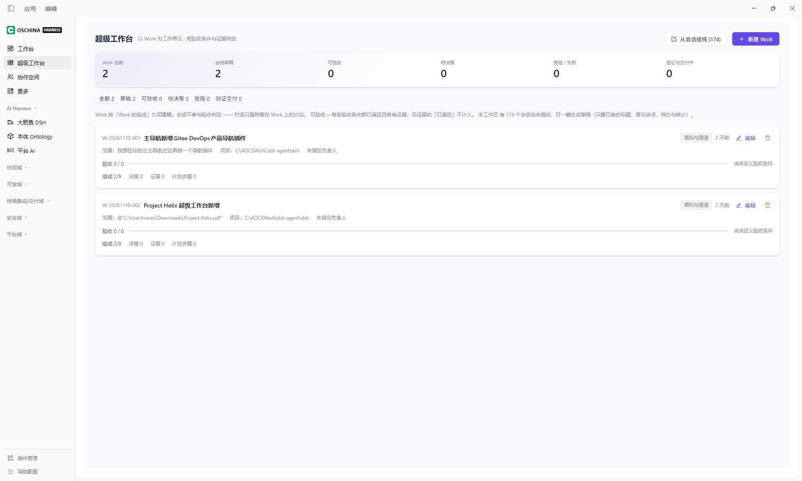
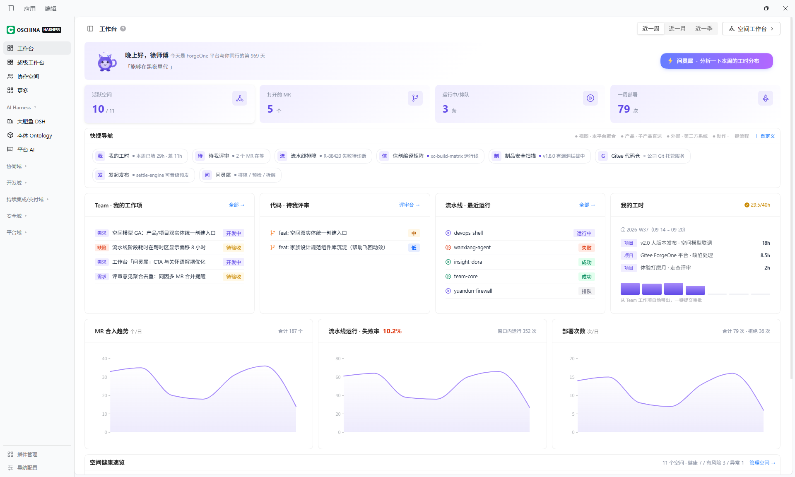
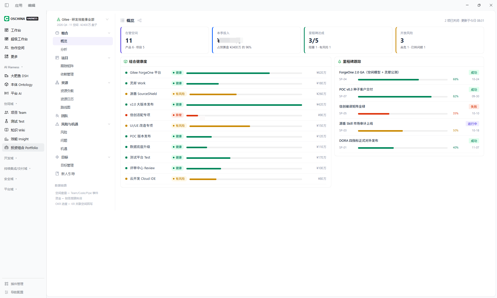
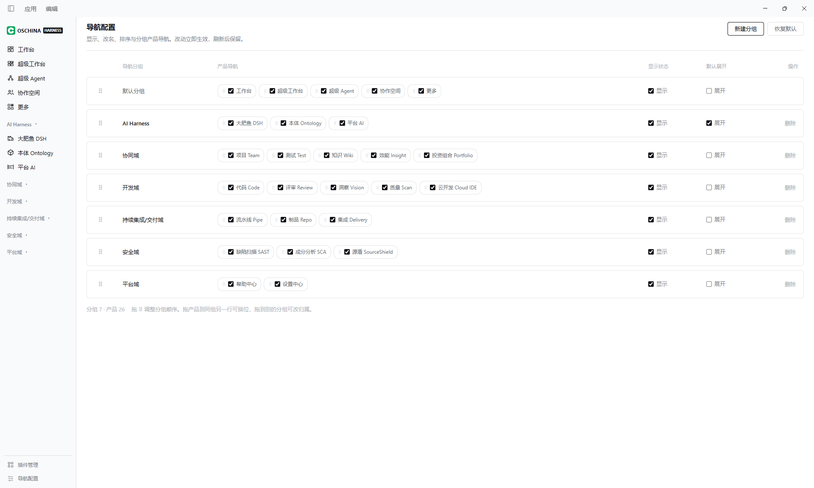

# dsh-osc-harness-sidebar

> 把 DeepSeek Harness 变成你自己的 Agent Harness
> —— 从「单模式 Agent 应用」扩展为「Agent + 多产品」，可作为多产品应用的外壳底座。

**[中文](README.md) | [English](README.en.md)**

[](https://www.npmjs.com/package/dsh-osc-harness-sidebar)
[](LICENSE)
[](package.json)
[](https://github.com/feralpixel2026/dsh-osc-harness-sidebar/actions/workflows/ci.yml)

`dsh-plugin` `dsh-bundle` `deepseek-harness` `cordis` `sidebar` `navigation` `ai-agent`

DSH 把 `sidebar` 设计成一个**席位**，默认只画会话列表。这个区域本来允许插件接入，但接上去之后页面往往变得冗长、复杂：一堆能力挤在同一个列表里，没有分组、没有主次、也不能由用户调整。本插件把它改造成能容纳任意能力的导航轨，并把「产品」这个概念引入了侧栏。

---

## 目录

- [它解决什么](#它解决什么)
- [本包只提供外壳](#本包只提供外壳)
- [界面](#界面)
- [实践效果](#实践效果)
- [快速开始](#快速开始)
- [重要：本插件不含具体能力](#重要本插件不含具体能力)
- [内置项：大肥鱼 DSH](#内置项大肥鱼-dsh)
- [导航配置](#导航配置)
- [写一个插件接入这个导航](#写一个插件接入这个导航)
- [安装是怎么做的](#安装是怎么做的)
- [注意事项](#注意事项)
- [兼容性](#兼容性)
- [包结构](#包结构)
- [文档](#文档)
- [开发](#开发)
- [安全边界](#安全边界)
- [相关插件](#相关插件)
- [许可证](#许可证)

---

## 它解决什么

DSH 把左列设计成一个**席位**（seat）：谁占住它，左列就长什么样。默认的 `ui-sidebar` 占着它，画的是会话列表——对「一个对话应用」来说这是合适的形态。

问题出在它被当作承载更多能力的地方之后。这个区域本身是开放的，任何插件都能接管，但**接上去容易、接得清楚难**：一个个能力往同一个列表里加，最后变成一条又长又杂的侧栏，靠滚动查找，没有分组、没有主次，用户也没法按自己的用法调整。

## 它做了什么

把侧栏从「一个列表」改成「一条轨道 + 一层二级导航」：

```
┌──────────────┬────────────────────────┐
│  产品轨       │  当前产品的二级导航      │   ← 左列被切成两半
│  （本插件）   │  （由各产品插件提供）    │
└──────────────┴────────────────────────┘
```

- **分组、排序、显隐**全部可视化配置，改的是本地配置，不用重装插件。
- **原生能力没有被替换**。会话列表与 Agent 循环仍在，只是变成轨道上的其中一项——所以这不是「换一个应用」，而是在原有能力旁边叠加产品能力。
- **产品可以自带二级导航**。占住 `sidebar.columns` 席位即声明右列；未声明的产品不渲染右列（这一条是显式声明，不由外壳猜测）。

## 为什么能这样

因为 DSH 是 Cordis 全插件架构：席位（seat）是开放的，一个页面产品的接入成本低到「一行导航 + 一个页面」。

这意味着接一个产品不需要改本插件、不需要重新构建、也不需要发版——注册两行就出现。

## 让 DSH 自己写插件

配合 DSH 内置的 `cordis-plugin-development` 能力，可以直接用自然语言让它给自己长出新能力，提示词可以只有一句：

> 做一个简单页面插件，放到 `sidebar.products` 产品导航

协议细节（两行注册、五个保留字段、右列的三次声明）见 [写一个插件接入这个导航](#写一个插件接入这个导航)。

## 本包只提供外壳

**本包不含任何具体产品。** 装好之后你得到的是空的轨道和原生会话，做成什么样取决于你往里接什么。

README 里的截图来自本地已接入的产品插件（Gitee DevOps 系列），**那些产品不在本包内**，也不在 npm 上——它们只是演示这套外壳能承载什么。如果只想要一个能直接用的产品集合，本包不是那个东西。

---

## 界面

左侧栏变成：

```
OSCHINA HARNESS              ← 品牌标

默认分组（无标题）
  工作台 / 超级工作台 / 协作空间

  更多                        ← 默认分组的最后一行：创建你的插件 / 浏览插件

AI Harness
  大肥鱼 DSH                 ← 内置项：点它回接 DSH 原生会话
  本体 Ontology              ← 需装 dsh-product-ontology
  平台 AI                    ← 需装 dsh-product-platform-ai

──── 底部 ────
  插件管理
  导航配置                    ← 分组、排序、显隐都在这里配
```

- **产品轨**：分组标题 + 各能力注册的行，带展开/收起
- **导航配置**：可视化增删分组、改名、拖动排序、显隐开关
- **大肥鱼 DSH**：内置出口，点它切开右侧列、恢复 DSH 原生导航
- **更多**：默认分组的最后一行，见下节

**首次安装只显示上面这两组**，其余业务域分组默认隐藏。要在配置页里打开。

### 两处「更多」

默认分组末尾和右列面板列表末尾各有一个「更多」。**两者的用途不同，不是同一个菜单的两份拷贝。**

| 位置 | 菜单内容 | 用途 |
|---|---|---|
| **产品轨 · 默认分组末尾** | 创建你的插件 / 浏览插件 | 给这条导航**加东西**。第一项开一个 cordis 会话，编辑器里预置引导语；第二项打开插件管理。放在默认分组内，所以收起该组时它一起隐藏——它就是这一组的一行 |
| **右列面板列表末尾** | `sidebar.panellist.actions` 席位注册的行（`ui-entry-customization` 提供未固定面板与两个插件动作），外加未固定面板的兜底行 | **找回被收起来的面板**。位置与原生 `ui-sidebar` 一致（面板行之后），因为它就是原生那个入口在本壳里的对应物 |

产品轨那个是**本壳特有**的：原生侧栏没有对应物，它的引导语也不一样（原生那个开的是空编辑器）。右列那个是**还原原生**：`sidebar.panellist.actions` 这个席位一直声明着，第三方也一直往里注册，此前只是没有出口。

两处的图标都取自 `@deepseek-ai/dsh-client-ui-primitives` 的图画（16 单元坐标系、1px 描边），不是自绘近似。

#### 产品轨「创建你的插件」的引导语

只有一句半：让 agent **先找到本插件的安装目录**，读 README 里「写一个插件接入这个导航」一节，按那里的协议实现；找不到 README 就退回 DSH 标准插件形态。末尾留产品名称、id、页面内容三个空位。

不内嵌协议、不写死路径。理由：

- 写死路径在别人机器上不成立——本机是 `link:` 安装，多数用户是 npm 安装，包目录不同；
- 内嵌协议会与这份 README 各自漂移，改一处就有一处是错的。

---

## 实践效果

以下都是在本机实际装好、由 DSH 按上面的提示词当场产出插件后的样子。










---

## 快速开始

### 前置

- DSH 0.2.x
- Node.js >= 22

### DSH 有两个版本，装法不同

| 形态 | 装法 |
|---|---|
| 桌面版（Electron） | 方式 A |
| Web 版（浏览器） | 方式 B |
| 已在 DSH 会话里 | 方式 C |

### 方式 A：桌面版（推荐）

1. 打开 DSH 桌面版
2. 设置 → 插件 → 从 npm 安装
3. 输入 `dsh-osc-harness-sidebar@latest`
4. 重启 DSH


### 方式 B：Web 版

在 profile 目录（如 `~/.dsh/profiles/desktop/`）执行：

```sh
npm install dsh-osc-harness-sidebar@latest
```

然后编辑同目录的 `package.json`，在 `bundles` 数组中加入：

```json
"bundles": [
  "...",
  "dsh-osc-harness-sidebar"
]
```

重启 DSH Web 服务。

### 方式 C：已在 DSH 会话里

把这个仓库地址发给 DSH 的 Agent，让它按方式 B 操作。

### 验证装好了

```sh
# 确认包在位
ls ~/.dsh/profiles/desktop/node_modules/dsh-osc-harness-sidebar

# 确认 bundles 里声明了
grep dsh-osc-harness-sidebar ~/.dsh/profiles/desktop/package.json
```

浏览器刷新后，左列应变成产品轨。

> **从旧版本升级**：已有的分组显隐配置会被保留。若希望回到新的出厂默认（只显示默认分组与 AI Harness），在「导航配置」里点一次**恢复默认**。

---

## 重要：本插件不含具体能力

**本插件只提供外壳：分组、排序、显隐、配置页。**

轨道上的具体能力由**其他插件**各自注册：

| 装上 | 会看到 |
|---|---|
| 只装本插件 | 分组标题 + **大肥鱼 DSH** + 配置页；`AI Harness` 之外的分组是空的 |
| 再装能力插件 A | 轨道上出现 A 那一行，点开是 A 的页面 |

**这是设计而非缺陷**：能力可以按需安装、单独升级、单独卸载，装不装某个能力不影响外壳。

---

## 内置项：大肥鱼 DSH

`大肥鱼 DSH` 是唯一内置的轨道项，它不是一个独立插件。

点它等价于**回到 DSH 原生会话**——右侧列恢复成会话区，DSH 自己的导航回到原位。它是「从产品模式退回会话模式」的出口，因此必须由外壳本身持有：它需要调用 `ctx.layout.selectPanel(null)`，那是外壳才有的能力。

---

## 导航配置

底部「导航配置」打开配置页，可以：

| 操作 | 说明 |
|---|---|
| **新建分组** | 分组即刻出现在轨道上 |
| **重命名** | 点分组名后面的铅笔图标，或双击分组名，回车保存 |
| **拖动排序** | 按住行首的拖动手柄拖动，松手生效 |
| **显示 / 隐藏** | 隐藏的分组从轨道上消失，其下产品自动落回默认分组 |
| **默认展开** | 控制该分组进页面时是否展开 |
| **删除分组** | 该分组下的产品不会被删除，回到默认分组末尾 |

### 默认分组的行为

列表第一个是**默认分组**（不画标题）。它承接所有「无归属」的产品，身份完全固定：

- 不能隐藏
- 不能设为收起
- 不能删除
- **不能改名**

**隐藏或删除某个分组时，它下面的产品会被追加到默认分组已有产品之后，不会消失。**

配置改动即时生效，刷新后保留。

---

## 写一个插件接入这个导航

本插件不硬编码任何产品。轨道上有哪几行，完全由插件通过槽位注册决定。

### 槽位清单

注册进 `sidebar` 席位后，本插件声明了下列子槽位。第三方插件按名字注册即可。

| 槽位 | 类型 | 作用 |
|---|---|---|
| `sidebar.products` | list | **产品行**。注册一行 = 轨道上多一项 |
| `sidebar.content` | keyed | **二级导航**。产品被选中时渲染在右列，可不注册 |
| `sidebar.columns` | list | 声明「我准备了一列」 |
| `sidebar.columns.visible` | list | 声明「这一列现在要占地方」 |
| `sidebar.columns.collapsed` | list | 声明「这一列强制收起」，优先级最高 |
| `sidebar.rail.account` | list | 页脚扩展位，在「插件管理」正下方 |
| `sidebar.panellist.actions` | list | 右列「更多」菜单里的行。往这里注册，行就出现在那个菜单里（`ui-entry-customization` 装了就由它注册未固定面板与两个插件动作） |

分组不是槽位：**组别由本插件根据行 id 计算**，用户可以在导航配置页把任意行拖到任意分组。所以新插件不需要知道分组 id。

> `sidebar.products.g-*` 这五个旧分组槽仍然保留声明，只为让老插件不报错。壳不渲染它们，`sidebar.products` 才是唯一收集槽。

> `sidebar.panellist.actions` 收到的 props 是 `{ entries, onOpen, onPinnedChange, onDismiss }`：`entries` 是未固定面板的投影，`onOpen(id)` 切换面板，`onPinnedChange(id, pinned)` 改固定状态，`onDismiss()` 关闭菜单。壳在席位没有注册时自己列出 `entries`，所以缺了 `ui-entry-customization` 菜单也不会是空的。

### 语义化开发

不用写代码，把这句话交给 DSH：

> 做一个简单页面插件，放到 `sidebar.products` 产品导航

DSH 会读本仓库的槽位协议、以 `dsh-product-*` 为模板产出完整插件包并打包好。你只需要把它挂进 profile。


### 最小可运行示例

一个完整的客户端插件包，注册一行导航和一个页面：

```js
// lib/client.js — 由 window.__ModuleLoader__ 加载
window.__ModuleLoader__.load({
  id: 'dsh-product-hello',
  factory: (require) => {
    const react = require('react')
    const h = react.createElement

    return {
      name: 'dsh-product-hello',
      apply(ctx) {
        const ID = 'product-hello'

        // 1. 轨道上的一行
        ctx.slots.inject('sidebar.products', () => ctx.slots.register({
          name: 'sidebar.products',
          id: ID,
          order: 100,
          label: 'Hello',
        }, function RailRow() {
          return h('span', null, 'Hello')
        }))

        // 2. 选中后主内容区的页面
        ctx.slots.inject('main', () => ctx.slots.register(
          { name: 'main', key: ID },
          function Page() {
            return h('div', { style: { padding: 24 } }, 'Hello, Harness')
          },
        ))
      },
    }
  },
})
```

配套的 `package.json` 与补丁：

```json
{
  "name": "dsh-product-hello",
  "version": "1.0.0",
  "type": "module",
  "main": "lib/index.js",
  "dsh": {
    "client": { "entry": "lib/client.js" },
    "bundle": { "patch": "cordis.patch.yml" }
  }
}
```

```yaml
# cordis.patch.yml
- insert:
    - id: dsh-product-hello
      name: dsh-product-hello
```

`lib/index.js` 是 Host 侧的空壳，导出 `export function apply() {}` 即可。

### 注册选项里只有三个字段会被读取

本插件从注册项上只读三个字段：`id` / `label` / `order`。**其余自定义字段一律被丢弃**——这就是 `sidebar.columns` 单独存在的原因：想让某一行被选中时保留右列，要往 `sidebar.columns` 再注册一行，不能挂在产品行上。

（`key` 与 `priority` 由槽位运行时消费：前者给 `keyed` 席位做索引，后者决定 `single` 席位的争夺结果。它们不是本壳渲染时会读的数据。）

### 右列（二级导航）

产品需要右列时，注册进 `sidebar.content`，并用同一个 id 作为 key：

```js
ctx.slots.inject('sidebar.content', () => ctx.slots.register({
  name: 'sidebar.content',
  key: ID,
}, function SubNav() {
  return h('nav', null, '二级导航')
}))
```

**还要两个声明，缺一不可。** 只注册 `sidebar.columns` 不会占地方——这是最容易踩的坑。

```js
// 1. 声明「我准备了一列」
ctx.slots.inject('sidebar.columns', () => ctx.slots.register({
  name: 'sidebar.columns',
  id: ID,
}))

// 2. 声明「这一列现在要占地方」——少了这条，右列不出现
ctx.slots.inject('sidebar.columns.visible', () => ctx.slots.register({
  name: 'sidebar.columns.visible',
  id: ID,
}))
```

**为什么拆成两次**：`slots.register` 只保留 `key` / `id` / `order` / `label` / `priority`，插件没法在产品行上附带「这一列现在有没有内容」。内容动态为空时，壳看到的仍是「已声明」，于是留一条空白列。拆开后插件能在内容为空时取消 `visible`，壳体不替它猜。

**两条都不注册的产品不占右列**，主内容区吃满宽度。大多数页面不需要右列，强制留白会白扔四分之一屏。

要强制收起时注册 `sidebar.columns.collapsed`（同 id），优先级高于前两者，不必注销它们。

### 注册时机

所有对子槽位的注册必须写在 `ctx.slots.inject('sidebar', ...)` 之后。`sidebar.products` 等槽位由本插件接管 `sidebar` 席位时才存在，在 `apply` 顶层直接注册会抛 `slot is not declared` 并中断整个 `apply`，表现为左列空白、只有重启才好。

### 图标

产品行的图标通过 `sidebar.products` 那一行的 slot 内容提供，本插件以 `renderSlot(section.slot, { size: 18, active }, { only: entry.id })` 渲染，尺寸 18、随选中态切换颜色。

### 完整指南

上面是速览。逐步教程、可复制的包结构、样式隔离与自检清单见 [docs/writing-a-plugin.md](docs/writing-a-plugin.md)；
四条不可违反的硬性要求见 [docs/integration.md](docs/integration.md)。

---

## 安装是怎么做的

DSH 的插件系统是 Cordis。本插件提供三个文件：

| 文件 | 作用 |
|---|---|
| `index.js` | Host 侧入口，`apply()` 为空——不需要任何 Host 服务 |
| `client.js` | 浏览器侧全部实现，由 DSH Web shell 通过 `dsh.client` 清单加载 |
| `cordis.patch.yml` | 禁用 `ui-sidebar`、占用 `sidebar` 席位 |

**禁用 `ui-sidebar` 写在 bundle 补丁里，而不是你的 profile 补丁里**——这样卸载本插件时，原生侧栏会自动恢复，不会留下半残状态。

---

## 注意事项

### 与其他侧栏插件互斥

本插件接管 `sidebar` 席位。**不要与其他接管同一席位的侧栏插件同时启用**，否则会出现 `already declared` 错误或列宽错乱。

### 依赖

**零运行时依赖。** 不依赖任何其他插件或共享库，可以单独安装、单独卸载。

---

## 兼容性

| 项 | 值 |
|---|---|
| DSH | 0.2.x |
| Node.js | >= 22 |
| 平台 | Web（`dsh.client.platform` 为 `web`）与 Electron 桌面版 |
| 注入的客户端服务 | `@deepseek-ai/dsh-client-locale`、`@deepseek-ai/dsh-client-ui-slots` |
| 视口下限 | 390px（`dsh-responsive-ui` 的验收最小宽度） |
| 浏览器 | Safari 16.4+、Chrome 111+、Edge 111+（用到 `color-mix()` 与 `:has()`） |

---

## 两列几何

左侧占用的宽度是**设计常量**，不随宿主报告的列宽变化：

| 状态 | 产品轨 | 导航列 | 整列 |
|---|---|---|---|
| 展开 | 180 | 240 | **420** |
| 产品轨收起 | 56 | 240 | 296 |
| 整列收起 | 56 | — | 56 |

`SIDEBAR_MAX_WIDTH = 420` 与 ui-layout 的上限一致，启动时通过能力探测把列拉到 420。

**不要把这三个数和 `props.width` 联动。** `props.width` 是 ui-layout 对「我们钉下的轨道」的回报，
拿它反算产品轨宽度会形成循环依赖：收起时钉 296 → 宿主回报 296 → 展开时仍按 296 推算，产品轨回不到
180、导航列被压到 100。同理，`useSoloTrack` 的 `widthFor` 不能与 `hostWidth` 取 `Math.min`。

窄视口不需要插件兜底：ui-layout 在视口小于 1024px 时报 `collapsed`，小于 768px 时把整列变成覆盖在
内容之上的抽屉。390px 下本插件渲染 56px 的图标轨，没有横向滚动。

## 触屏与辅助功能

| 约定 | 做法 | 原因 |
|---|---|---|
| 悬停只在有指针时生效 | 全部 21 条 `:hover` 包进 `@media (hover: hover)` | 触屏没有「指针离开」，裸 `:hover` 会粘连——点过的行一直高亮到点别处，与真实选中态冲突 |
| 减少动态效果 | `@media (prefers-reduced-motion: reduce)` 把过渡与动画时长压到 0.01ms | 清的是时长而非属性，布局与配色仍立即生效 |
| 输入框触屏 16px 下限 | `@media (pointer: coarse) { .pn-name-input { font-size: 16px } }` | iOS Safari 聚焦 font-size < 16px 的输入框时整页放大且失焦不还原，期间固定的列宽几何一起失真 |
| 选中态只改底色与文字色 | `.pn-item[data-active]` 不写 `font-weight` / `font-size` | 字重变化会改变字形宽度，被选中的行比相邻行粗一档并左右抖动 |

`(pointer: coarse)` 查的是主指针类型而非当前事件，所以带触控板的混合设备仍走紧凑值。

---

## 包结构

单文件前端包，**没有构建步骤**：

```
index.js             Host 侧入口（无 Host 服务，apply 为空）
client.js            浏览器侧全部实现（含样式）
cordis.patch.yml     bundle 补丁：禁用 ui-sidebar，占用 sidebar 席位
icon.svg             图标
locale/zh.json       包元信息（文案字典内联在 client.js）
locale/en.json       包元信息
docs/                接入方文档（随包发布）
test/                node --test 单测（不随包发布）
```

`client.js` 是手写并经过验证的产物，不经过打包器。样式以内联 CSS 形式随包分发，运行时挂到产品页容器上，作用域限定在容器内，不影响宿主样式。

---

## 文档

| 文件 | 内容 |
|---|---|
| [CHANGELOG.md](CHANGELOG.md) | 版本变更记录 |
| [CONTRIBUTING.md](CONTRIBUTING.md) | 贡献指南 |
| [SECURITY.md](SECURITY.md) | 安全策略与漏洞报告 |
| [docs/dshell-ui-architecture.md](docs/dshell-ui-architecture.md) | DSH 侧栏席位与网格几何的实测记录 |
| [docs/README.md](docs/README.md) | 文档索引 |
| [docs/writing-a-plugin.md](docs/writing-a-plugin.md) | **写一个产品插件：逐步指南** |
| [docs/integration.md](docs/integration.md) | 四条不可违反的硬性要求 |
| [docs/screenshots/](docs/screenshots/) | README 截图与命名约定 |

---

## 开发

本仓库只包含运行时文件，不包含构建流程。

```sh
npm run check    # 语法检查
npm test         # 运行测试
npm run verify   # check + test（发布前自动执行）
```

修改 `client.js` 后需重新加载 DSH 的 Web 界面。

---

## 安全边界

本插件：

- **不发起任何网络请求**
- **不读取任何用户文件**（除 `localStorage` 保存的导航配置）
- **不提升任何权限**
- 唯一的持久化是浏览器 `localStorage` 中的分组配置

安全问题的报告方式见 [SECURITY.md](SECURITY.md)。

---

## 相关插件

本插件是外壳，不含具体能力。若需要配套的能力插件，见 `dsh-product-*` 系列（每个是一个独立插件，各自提供一行导航和一个页面）。

---

## 许可证

[Apache-2.0](LICENSE)
